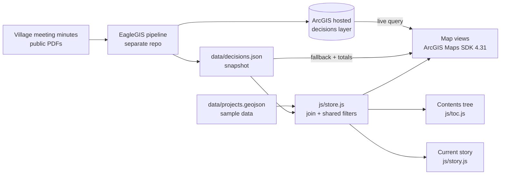

# Where Estero Decides

An interactive map of ten years of public decisions in Estero, Florida, organized so a resident can go from a place on the map to the project, the vote and the source document.

Built for [Engage Estero](https://esterotoday.com) by the EagleGIS student team at Florida Gulf Coast University.

> [!NOTE]
> **Who this is and is not.** Engage Estero is an independent community nonprofit. This site is not an official Village of Estero product and does not speak for the Village government. The decisions shown come from public Village Council and Planning Zoning & Design Board minutes, and every decision links back to its source document.

> [!IMPORTANT]
> **Status: working prototype.** The decisions layer is real (2,618 agenda items, 712 of them with map coordinates). The Projects layer that groups decisions by sponsor and category is **sample data** for layout and symbology and has not been verified.

## What is in this repository

| In this repo | Not in this repo |
|---|---|
| The static map site: contents tree, filters, story view, drive, council cases, hotspot game, timeline | The question-answering assistant ("Ask Engage Estero"), which lives in [rag-arcgis-chatbot](https://github.com/noleysc/rag-arcgis-chatbot) |
| A snapshot of the decisions data (JSON and cleaned CSV) | The PDF extraction pipeline and database that produced the records, in [EagleGIS](https://github.com/EagleGIS-FGCU/EagleGIS) |
| ArcGIS setup notes and the project data schema | Any server, API or AI model. This site is HTML, CSS and JavaScript only |

## How the pieces fit



## Tech stack

Plain HTML, CSS and JavaScript with no build step. Maps use the ArcGIS Maps SDK for JavaScript 4.31. Hosted on GitHub Pages.

## Navigation model

The map works as a table of contents:

1. **Sponsor group**: Private development, Village of Estero, Lee County & state
2. **Category**: private `dev_type`, Village CIP category, or county/state program
3. **Project**
4. **Decisions**: deciding body and outcome
5. **Source documents**: minutes today, plus agendas and ordinances when added to a project

## Sections
1. **Explore the map**: the live EagleGIS web map plus the Projects layers, with the contents tree, a shared year range, layer checkboxes and the original decision filters
2. **Current story**: a plain summary generated from the data, in the same hierarchy, with source links
3. **Take the drive**: pick a road; decisions along it open in the contents
4. **You're on the council**: five real cases, framed by deciding body and outcome
5. **Guess the hotspot**: find the busiest spot, then open its projects and latest decision
6. **A look back**: the year slider; it sets the year range for the whole page

Drive, council, hotspot and timeline are side doors: their results open the matching project or decision in the contents.

## How it works
- Static site, no build step. GitHub Pages serves it as is.
- Maps use the ArcGIS Maps SDK for JavaScript 4.31.
- Explore loads web map `84a56d2f741d49f5a70c547923fb45d5` (decisions layer, symbols, clusters and popups come from ArcGIS) and adds the Projects as client-side feature layers, one per geometry type, each filtered from the one dataset.
- Drive, hotspot and timeline maps query the decisions feature layer live. If it's down, they fall back to the snapshot.
- Live rows are matched to `RecordId`s by date + board + item number.

### Code
| File | What it does |
|---|---|
| `js/store.js` | Loads `data/projects.geojson` + `data/decisions.json`, joins them by `decision_ids`, holds the shared filter state (group, category, project, decision, year range, hidden layers) |
| `js/symbology.js` | Category colors, sponsor shapes, status styles; ArcGIS symbols and SVG swatches from one config; map key |
| `js/toc.js` | Contents tree, breadcrumb, deep links (`#project=VOE-RD-01`, `#decision=vc:297`), `WED.toc.focus()` |
| `js/story.js` | Current story. `WED.story.setProvider(fn)` is the hook for Ask EagleGIS to write it |
| `app.js` | Maps and the chapter sections |

### Data
- `data/projects.geojson`: one schema for all sponsors. See `docs/projects_schema.md`. **Currently sample data.**
- `data/decisions.json`: snapshot of all 2,618 agenda items. Header totals, the contents, the story and the fallback for the maps.
- `data/estero_decisions_*.csv`: cleaned exports. `docs/arcgis_setup.md` has the ArcGIS setup notes.

## Run locally
```
python3 -m http.server 8000
```
Then open http://localhost:8000. Opening `index.html` straight from disk won't work because the page fetches its data files.

## Publish
Settings → Pages → Deploy from a branch. The live site at https://krocks9903.github.io/where-estero-decides/ has been deploying from the `live-webmap` branch. The table-of-contents work described above was developed on `toc-hierarchy`. Point Pages at whichever branch should be public.

## Known data gaps
- No 2018 records in the decisions snapshot.
- Snapshot ends June 17, 2026.
- Some geocodes are off (see `docs/arcgis_setup.md`).
- Project data is sample data until replaced with verified records.

## Team and credits

Built by the EagleGIS team at FGCU for Engage Estero. Source records are public Village of Estero meeting minutes. Basemaps and hosted layers are provided through ArcGIS Online.
